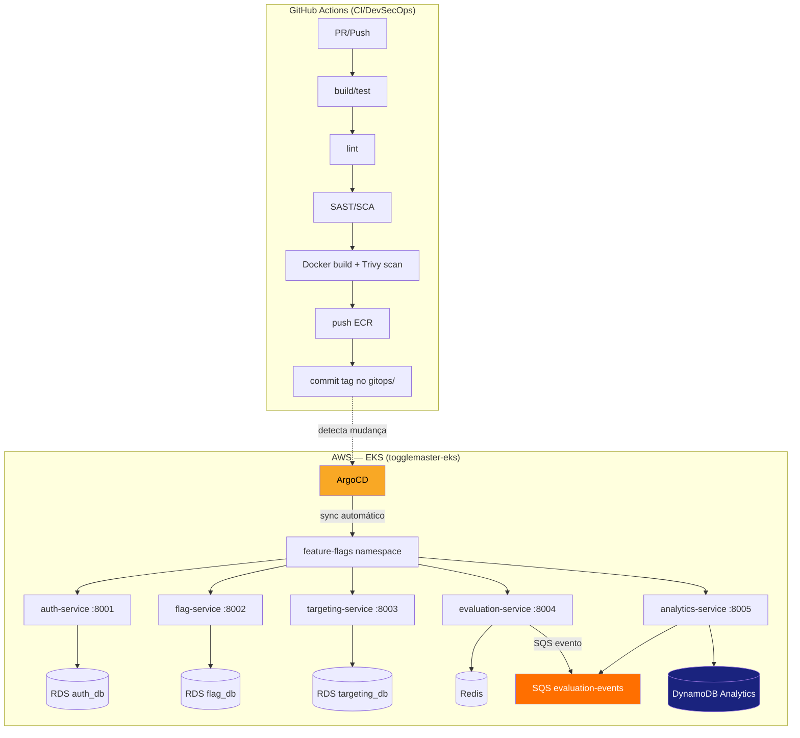

# ToggleMaster — Resumo do Projeto, Custos e Arquitetura

> Conta AWS: **248530551510** · Região: **us-east-1** · Status atualizado em 14/set/2026

---

## 1. O que foi feito até agora (checklist de entrega)

| Etapa | Status | Detalhe |
|---|---|---|
| **IaC — Terraform** | Concluído | VPC, EKS, 3× RDS, ElastiCache Redis, DynamoDB, SQS/DLQ, 5× ECR, OIDC GitHub Actions — tudo via módulos Terraform com backend S3 remoto (`togglemaster-tfstate-248530551510`). |
| **Camada 2 — ArgoCD** | Concluído | Instalado via Kustomize (`kbst/kustomization`). State próprio separado. |
| **GitOps — Kustomize** | Concluído | `gitops/base/` (namespace, configmap, secrets, ingress, HPA, KEDA, service accounts) + `gitops/apps/<svc>/` (5 deployments + services). ArgoCD Applications registradas e em sincronia automática (automated + prune + selfHeal). |
| **CI — GitHub Actions** | Concluído | 5 pipelines DevSecOps (`_ci-reusable.yml` + um workflow por serviço): build → test → lint → SAST (gosec/bandit) → SCA (Trivy FS) → container scan (Trivy image) → push ECR → commit tag no GitOps. |
| **Segurança** | Concluído | OIDC federation (sem access keys estáticas), trust policy restrita (main/PR/environments), secrets gerenciados via Kubernetes Secrets produzidos pelo Terraform, ECR scan on push. |
| **ArgoCD — Aplicações** | Concluído | Todas as 5 Applications `Synced` e `Healthy`. Pods rodando: auth×2, flag×2, targeting×2, evaluation×2, analytics×1. |
| **Documentação e cenas de demo** | Concluído | Roteiro de apresentação, guia da cena GitOps/ArgoCD, roteiro de vídeo, scripts (`provocar-*`, `reverter-*`, `preparar-apresentacao.sh`). |
| **Autoscaling** | Concluído | Manifests definidos no GitOps: HPA (CPU) para evaluation-service (2–10 réplicas) e KEDA ScaledObject (fila SQS) para analytics-service (1–10 réplicas). |
| **Ingress (exposição externa)** | Concluído | Ingress resource definido no GitOps (`api.togglemaster.com`, 5 rotas `/auth`, `/flags`, `/rules`, `/evaluate`, `/analytics`). Ativar o controller em runtime é opcional. |

---

## 2. Próximos passos e recomendações

### Próximos passos (entrega) — nada a instalar

| # | Ação | Motivo |
|---|---|---|
| 1 | Capturar screenshots das 5 Applications Synced/Healthy e dos pods | Evidência obrigatória do desafio (ArgoCD UI + `kubectl get pods`) |
| 2 | Gravar/apresentar com o roteiro e cenas prontos em `docs/` | Rotear da apresentação, vídeo, e scripts `provocar-*`/`reverter-*` já existem |
| 3 | Registrar o resumo de custos (este documento) | Requisito de custos com o link do AWS Calculator |
| 4 | Opcional — remover o ambiente ao final dos testes | Evitar custos residuais (`terraform destroy`) |

### Melhorias para produção (não são obrigatórias, não exigem instalação agora)

- Publicar o ambiente com **ingress-nginx + TLS/cert-manager** quando for expor para internet
- **Karpenter** / Spot instances para reduzir custo de EC2 (~60-70%)
- **Multi-AZ RDS** para alta disponibilidade
- **WAF** no balanceador e **AWS Budgets** com alerta de custo
- **tfsec/checkov** no pipeline para IaC security (adição leve ao CI)

---

## 3. Estimativa de custo (AWS Pricing — us-east-1, on-demand)

### Preços unitários de referência (set/2026)

| Componente | Preço unitário | Fonte |
|---|---|---|
| EKS cluster (1 cluster) | US$ 0,10 /hora | AWS Pricing API / Página oficial |
| t3.medium (Linux, on-demand) | US$ 0,0416 /hora | AWS EC2 Pricing |
| db.t4g.micro (PostgreSQL, single-AZ) | US$ 0,016 /hora | AWS RDS Pricing |
| Storage RDS (gp2, us-east-1) | US$ 0,115 /GB-mês | AWS RDS Pricing |
| cache.t4g.micro (Redis) | US$ 0,016 /hora | AWS ElastiCache Pricing |
| Storage gp3 (EBS, us-east-1) | US$ 0,08 /GB-mês | AWS EBS Pricing |
| NLB (quando instalado) | US$ 0,0225 /hora + LCUs | AWS ELB Pricing |
| DynamoDB (on-demand) | US$ 0,63 /milhão WUs + $0,13/M RUs | AWS DynamoDB Pricing (set/2026) |
| SQS (standard) | US$ 0,40 /milhão de requests | AWS SQS Pricing |
| ECR storage | US$ 0,10 /GB-mês | AWS ECR Pricing |
| S3 (Standard) | US$ 0,023 /GB-mês | AWS S3 Pricing |

### Composição mensal (30,4 dias × 24h = 730 horas)

| Recurso | Quantidade | Cálculo | US$/mês |
|---|---|---|---|
| EKS control plane | 1 | 0,10 × 730 | 73,00 |
| EC2 — t3.medium | 2 | 0,0416 × 730 × 2 | 60,74 |
| EBS gp3 (root volume, 20GB × 2 nodes) | 40 GB | 0,08 × 40 | 3,20 |
| RDS — db.t4g.micro | 3 | 0,016 × 730 × 3 | 35,04 |
| RDS storage (20GB × 3) | 60 GB | 0,115 × 60 | 6,90 |
| ElastiCache — cache.t4g.micro | 1 | 0,016 × 730 | 11,68 |
| DynamoDB (tráfego baixo, estimado) | — | ~1M writes + 1M reads/mês | ~0,75 |
| SQS (tráfego baixo, estimado) | — | ~500K requests/mês | ~0,20 |
| ECR (5 repos, imagens parciais) | ~5 GB | 0,10 × 5 | 0,50 |
| S3 (tfstate + docs) | ~1 GB | 0,023 × 1 | 0,02 |
| Data transfer (saída internet, estimado) | ~5 GB | 0,09 × 5 | 0,45 |
| **TOTAL SEM NLB** | | | **~193,00** |
| NLB (ingress-nginx, quando exposto) | 1 | 0,0225 × 730 + LCUs (~$4) | ~20,50 |
| **TOTAL COM NLB** | | | **~213,00** |

**Custo diário estimado:**

| Cenário | US$/dia |
|---|---|
| Sem NLB (sem acesso externo) | ~6,35 |
| Com NLB (acesso externo via Ingress) | ~7,01 |
| **Pro-ratamédia informada no README** | **~6,20** |

> Os valores são baseados nos preços on-demand de referência para us-east-1 (set/2026).
> Não há NAT Gateway no VPC do EKS, nem ELB Classic. Dois NATs visíveis no `aws ec2 describe-nat-gateways` pertencem a outro VPC (`vpc-*` diferente do `togglemaster-vpc`).

---

## 4. Link do AWS Pricing Calculator

O **AWS Pricing Calculator** (https://calculator.aws/#/) não disponibiliza API pública para criar estimativas programaticamente, nem para gerar links compartilháveis sem interação com a interface web. Para gerar o link compartilhável:

### Passo a passo (5 minutos)

1. Acesse **https://calculator.aws/#/**
2. Clique em **Create estimate**
3. Adicione os seguintes serviços (região: **US East (N. Virginia)**):

| Serviço | Configuração | Qty |
|---|---|---|
| Amazon EKS | Cluster price (horas) | 730 horas |
| Amazon EC2 | t3.medium, Linux, On-Demand, Shared tenancy | 1.460 horas (2 × 730) |
| Amazon RDS | db.t4g.micro, PostgreSQL 16, Single-AZ, 20 GB gp2 | 3 instâncias × 730 horas |
| Amazon ElastiCache | cache.t4g.micro, Redis, 1 node | 730 horas |
| Amazon DynamoDB | On-Demand, ~1M WU + ~500K RU/mês | Estimar conforme uso |
| Amazon SQS | Standard queue, ~500K requests/mês | Estimar conforme uso |
| Amazon ECR | Storage ~5 GB | 5 GB |
| Amazon S3 | Standard, ~1 GB | 1 GB |
| Amazon EBS | gp3, 20 GB × 2 volumes | 40 GB |
| Amazon VPC — NAT Gateway | *(não necessário)* | — |
| Amazon ELB — NLB | *(opcional — só ao expor via internet)* | 730 horas |

4. Clique em **Save** → **Share** → copie o link gerado com formato `calculator.aws/#/estimate?id=<uuid>`

> **Dica:** após salvar, o link compartilhável aparece em `About this estimate` → `Share estimate link`. Esse link mantém os parâmetros preenchidos e pode ser enviado como evidência para a banca.

---

## 5. Arquitetura

### Desenho simples

```
                        ┌─────────────────────────────────────────────────────┐
                        │                GitHub Actions (CI)                  │
                        │  PR/Push ─► build/test ─► lint ─► SAST/SCA ─►      │
                        │    Docker build ─► Trivy scan ─► push ECR           │
                        │         └──► commit tag no gitops/ ──► ArgoCD sync  │
                        └─────────────────────────────────────────────────────┘
                                                          │
                                                          ▼
 ┌──────────────────────────────────────────────────────────────────────────────────┐
 │                          AWS — Account 248530551510 / us-east-1                  │
 │                                                                                  │
 │  ┌─────────── VPC togglemaster-vpc (10.0.0.0/16) ────────────────────────────┐  │
 │  │                                                                             │  │
 │  │  Public Subnets (AZ a/b)                                                    │  │
 │  │  ┌────────────────────────────┐   ┌────────────────────────────┐           │  │
 │  │  │  EKS node t3.medium (a)    │   │  EKS node t3.medium (b)    │           │  │
 │  │  └────────────────────────────┘   └────────────────────────────┘           │  │
 │  │         │ pod: auth×2 flag×2 targeting×2                                   │  │
 │  │         │ pod: evaluation×2 analytics×1                                    │  │
 │  │         │                                                                  │  │
 │  │         ▼                                                                  │  │
 │  │  ┌─ Ingress nginx (futuro NLB) ─┐                                        │  │
 │  │  │  /auth      → auth-service   │                                        │  │
 │  │  │  /flags     → flag-service   │                                        │  │
 │  │  │  /rules     → targeting-svc  │                                        │  │
 │  │  │  /evaluate  → evaluation-svc │                                        │  │
 │  │  │  /analytics → analytics-svc  │                                        │  │
 │  │  └──────────────────────────────┘                                        │  │
 │  │                                                                             │  │
 │  │  Private Subnets (AZ a/b)                                                  │  │
 │  │  ┌────────────────────────────┐  ┌────────────────────────────┐            │  │
 │  │  │ RDS auth_db (db.t4g.micro) │  │ RDS flag_db (db.t4g.micro) │            │  │
 │  │  └────────────────────────────┘  └────────────────────────────┘            │  │
 │  │  ┌─────────────────────────────────┐  ┌────────────────────────────┐       │  │
 │  │  │ RDS targeting_db (db.t4g.micro) │  │ Redis (cache.t4g.micro)    │       │  │
 │  │  └─────────────────────────────────┘  └────────────────────────────┘       │  │
 │  │                                                                             │  │
 │  │  Managed Services (fora das subnets)                                       │  │
 │  │  ┌──────────────────┐  ┌───────────────────┐  ┌────────────────────┐       │  │
 │  │  │ DynamoDB         │  │ SQS (+ DLQ)       │  │ ECR (5 repos)      │       │  │
 │  │  │ ToggleMaster...  │  │ evaluation-events  │  │ togglemaster-*     │       │  │
 │  │  └──────────────────┘  └───────────────────┘  └────────────────────┘       │  │
 │  │                                                                             │  │
 │  └─────────────────────────────────────────────────────────────────────────────┘  │
 │                                                                                  │
 │  Outros: S3 (tfstate), IAM (OIDC GitHub Actions), EKS control plane             │
 └──────────────────────────────────────────────────────────────────────────────────┘
```

### Fluxo de dados (request)

```
cliente ──HTTPS──► Ingress nginx ──► evaluation-service
                                        │
                                        ├──► Redis (cache) ──► resposta (flag on/off)
                                        │
                                        └──► SQS (evento assíncrono)
                                                  │
                                                  ▼
                                          analytics-service
                                                  │
                                                  ▼
                                          DynamoDB (ToggleMasterAnalytics)
```

### Diagrama Mermaid (renderiza no GitHub)



---

## 6. Inventário real provisionado (AWS CLI, 14/set/2026)

| Recurso | ID/Nome | Status | Especificação |
|---|---|---|---|
| EKS cluster | `togglemaster-eks` | ACTIVE | Kubernetes v1.36 |
| EKS node group | `togglemaster-workers` | ACTIVE | 2× t3.medium (AL2023), AZ a+b |
| RDS | `togglemaster-auth-db` | available | db.t4g.micro, PostgreSQL 16.15, 20GB, single-AZ |
| RDS | `togglemaster-flag-db` | available | db.t4g.micro, PostgreSQL 16.15, 20GB, single-AZ |
| RDS | `togglemaster-targeting-db` | available | db.t4g.micro, PostgreSQL 16.15, 20GB, single-AZ |
| ElastiCache | `togglemaster-redis` | available | cache.t4g.micro, Redis, 1 node |
| DynamoDB | `ToggleMasterAnalytics` | — | PAY_PER_REQUEST |
| SQS | `tooglemaster-evaluation-events-queue` | — | Standard |
| SQS (DLQ) | `tooglemaster-evaluation-events-queue-dlq` | — | Standard |
| ECR | 5 repos (auth, flag, targeting, evaluation, analytics) | — | Scan on push |
| S3 | `togglemaster-tfstate-248530551510` | — | Versionamento + SSE |
| IAM OIDC | GitHub provider + role `togglemaster-github-ci-role` | — | Trust: repo + main/PR |
| ArgoCD | 5 Applications | Synced/Healthy | automated + prune + selfHeal |
| Pods (feature-flags) | 10 pods | Running | auth×2, flag×2, targeting×2, evaluation×2, analytics×1 |

> **Nota:** Ingress, HPA e KEDA já estão definidos nos manifests do GitOps. A execução do controller ingress-nginx e do metrics-server em runtime é opcional (não necessária para a entrega).

---

## Referências

- [AWS Pricing Calculator](https://calculator.aws/#/)
- [EKS Pricing](https://aws.amazon.com/eks/pricing/)
- [RDS Pricing](https://aws.amazon.com/rds/postgresql/pricing/)
- [ElastiCache Pricing](https://aws.amazon.com/elasticache/pricing/)
- [README do projeto](../../README.md)
- [Roteiro de apresentação](roteiro-detalhado.md)
- [Guia da cena GitOps + ArgoCD](gitops-argocd-demo.md)
